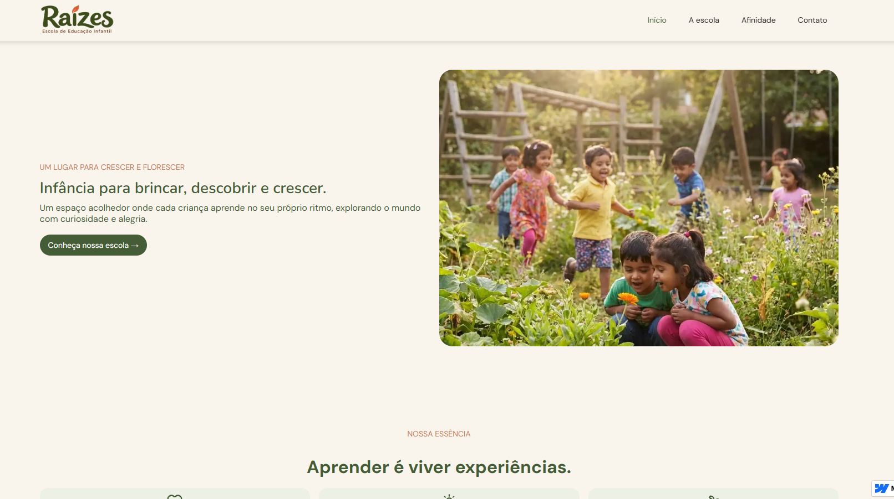
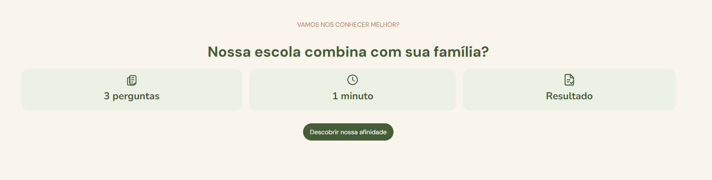
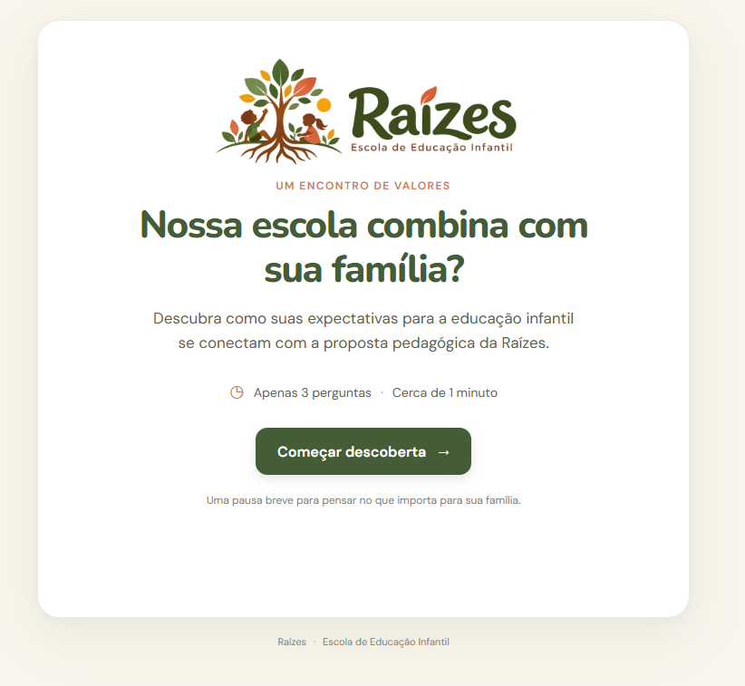
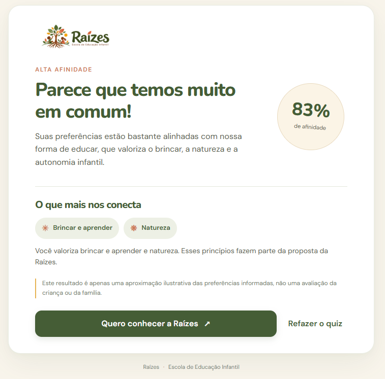
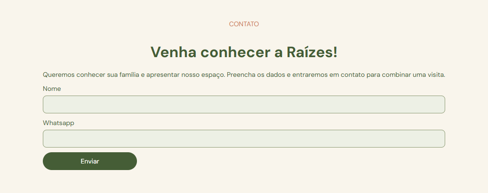
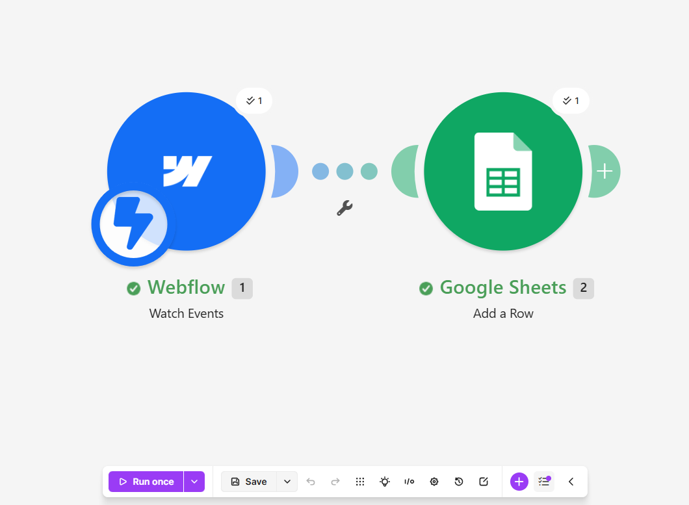
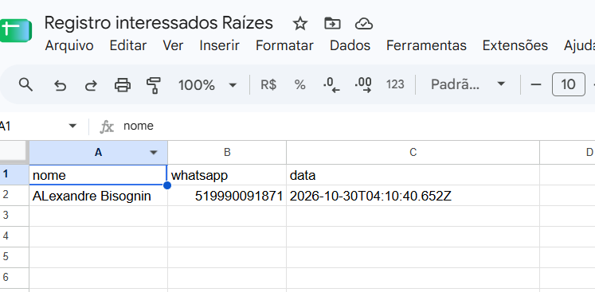

# Raízes — Escola de Educação Infantil

Projeto acadêmico desenvolvido para a disciplina **Padrões Web para No Code e Low Code**, do curso de **Inteligência Artificial e Automação Digital da UniFECAF**. A solução combina um site institucional criado no Webflow, um quiz interativo desenvolvido com HTML, CSS e JavaScript e uma automação de contatos descrita neste documento a partir do contexto do projeto.

## Apresentação do projeto

Famílias que procuram uma escola de educação infantil precisam conhecer a proposta pedagógica e avaliar se ela está de acordo com suas expectativas. O projeto Raízes apresenta uma escola fictícia que valoriza a aprendizagem pelo brincar, o contato com a natureza e a autonomia infantil.

A solução reúne o site institucional, um quiz de afinidade pedagógica e um formulário para manifestar interesse em uma visita. O quiz oferece uma reflexão breve e um resultado ilustrativo; não avalia a criança ou a família e não determina matrícula.

## Funcionalidades

### Site institucional (Webflow)

- Apresentação da escola e de sua proposta pedagógica.
- Navegação entre as seções do site.
- Formulário para registrar interesse em conhecer a escola ou agendar uma visita.
- Acesso ao quiz hospedado separadamente.

### Quiz de afinidade

- Três perguntas interativas sobre brincar e aprender, natureza e autonomia.
- Exibição de uma pergunta por vez, com opções de voltar e continuar.
- Respostas preservadas ao voltar para uma pergunta anterior.
- Cálculo de um percentual ilustrativo e apresentação de uma mensagem personalizada.
- Destaque para até dois pilares com maior conexão e opção de refazer o quiz.
- Botão “Quero conhecer a Raízes”, que retorna à seção de contato do site institucional.

### Automação de contatos

- O formulário do Webflow recebe o nome e o WhatsApp de pessoas interessadas.
- Um fluxo no Make processa os dados do formulário e registra as informações no Google Sheets.
- O fluxo também envia uma notificação por e-mail sobre um novo registro.

O quiz não envia respostas nem percentuais para o Make; a automação está ligada ao formulário do site institucional.

## Tecnologias e ferramentas

| Tecnologia | Utilização |
|---|---|
| Webflow | Desenvolvimento do site institucional responsivo e do formulário de contato |
| HTML5 | Estrutura semântica da interface do quiz |
| CSS3 | Identidade visual, componentes e adaptação a diferentes telas |
| JavaScript | Navegação entre perguntas, pontuação e personalização do resultado |
| Vercel | Hospedagem do quiz |
| Make | Processamento automatizado dos contatos enviados pelo formulário |
| Google Sheets | Registro dos dados dos interessados |
| E-mail | Notificação de novo registro gerado pelo fluxo do formulário |

O repositório contém os arquivos do quiz. As informações sobre o site Webflow e o fluxo do Make descrevem o contexto de integração do projeto; esses serviços e seus cenários não estão configurados ou demonstrados no código-fonte deste repositório.

## Funcionamento do quiz

O visitante responde a uma pergunta sobre cada um dos três pilares da proposta pedagógica: aprendizagem pelo brincar, natureza e autonomia. Cada alternativa atribui **0, 1 ou 2 pontos**, conforme o grau de proximidade com a proposta apresentada. Com três perguntas, a pontuação máxima é seis.

O percentual é calculado dividindo a soma dos pontos por seis e arredondando o resultado. A aplicação apresenta uma das seguintes faixas:

- **Alta afinidade:** de 67% a 100%.
- **Afinidade moderada:** de 34% a 66%.
- **Propostas diferentes:** de 0% a 33%.

Além da faixa, o quiz exibe uma mensagem correspondente ao resultado e destaca até dois pilares que receberam ao menos um ponto. Em caso de empate, a ordem das perguntas é mantida. Se todas as respostas receberem zero, o resultado traz um convite neutro para conhecer a proposta da escola. A mensagem final esclarece que o percentual é apenas ilustrativo.

## Integração e automação

O fluxo de contato do projeto é: **Webflow → formulário → Make → Google Sheets**, com uma notificação por e-mail quando um novo registro é processado. O formulário é o ponto de entrada dos dados de contato.

O quiz é uma aplicação estática hospedada na Vercel e acessada por um link no site Webflow. Ao final do quiz, o botão de contato retorna diretamente à seção de contato do site. O quiz não participa do fluxo de envio de dados ao Make.

## Padrões Web, responsividade e acessibilidade

HTML organiza o conteúdo do quiz; CSS define a apresentação visual e as regras para telas menores; JavaScript controla a navegação, o cálculo e os textos de resultado. Essa combinação permite criar no quiz uma experiência interativa própria, com perguntas passo a passo, preservação das respostas e retorno calculado, integrada ao site institucional no-code por meio de links.

O layout se adapta a dispositivos móveis com ajustes de espaçamento, tipografia, cartões e botões. A interface usa títulos e regiões semânticas, perguntas e opções agrupadas com `fieldset`, `legend` e controles de rádio, foco visível para navegação por teclado, botão de avanço desabilitado até a escolha de uma resposta e anúncios de conteúdo atualizado. A barra de progresso informa seu estado com atributos acessíveis, e a folha de estilos respeita a preferência do sistema por movimento reduzido.

## Acesso e demonstração

- **Site institucional (Webflow):** [https://raizes----escola-de-educacao-infantil.webflow.io/]
- **Quiz (Vercel):** [https://quiz-raizes.vercel.app/]

Para demonstrar a solução:

1. Acesse o site institucional e navegue até a seção do quiz.
2. Abra o quiz e responda às três perguntas, avançando entre elas.
3. Confira o percentual, a faixa e os pilares destacados no resultado.
4. Use “Quero conhecer a Raízes” para retornar ao site institucional.
5. Preencha o formulário de contato com os dados solicitados.
6. Conforme o fluxo previsto para o projeto, o envio do formulário aciona o Make, que registra o contato no Google Sheets e envia uma notificação por e-mail.

O código do quiz também pode ser aberto localmente pelo arquivo `index.html`, sem instalação de dependências. Para verificar o fluxo de automação, é necessário acesso ao site, ao formulário e aos serviços correspondentes.

## Evidências visuais

As referências abaixo indicam as capturas a serem adicionadas ao repositório em `docs/images/`. Os arquivos de imagem ainda precisam ser incluídos.

- Tela inicial do site institucional: 
- Seção do quiz no Webflow: 
- Interface do quiz: 
- Resultado personalizado: 
- Formulário de contato: 
- Cenário de automação no Make: 
- Registro no Google Sheets: 

## Considerações finais

O projeto demonstra como ferramentas no-code podem ser complementadas com HTML, CSS e JavaScript para oferecer uma interação personalizada, enquanto uma automação separada organiza os contatos recebidos pelo site. A integração dessas partes resulta em uma experiência que apresenta a proposta da escola e facilita o próximo passo para as famílias interessadas.
